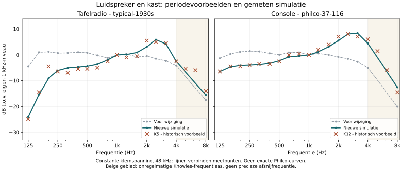

# Period acoustic evidence and the Radio1938 fit

The subsequent [detector/supply revision](radio1938-detector-supply.md) changes
the electrical drive and normal volume settings. The source-labelled acoustic
fits in this document remain unchanged; older complete-chain measurements
below should not be read as measurements of the latest circuit.

2026-11-05. This revision supersedes the acoustic estimates and acoustic
acceptance bands in the [July realism audit](radio1938-realism-audit.md).
Both receivers are source-anchored reconstructions, not measurements of the
Philco BO-1 or Type-W. No exact-part acoustic, impedance, phase, or polar data
has been established. `typical-1930s` does not mean a population average.

The [November 6 circuit revision](radio1938-realism-audit.md#circuit-corrections-and-remaining-limits-2026-11-06)
changes IF selectivity, first-audio characteristics and noise routing. The
measurements below describe the dated acoustic/oversampling revisions; use
that audit's new CSVs for current whole-receiver comparisons. The period
evidence and the residual acoustic EQ are unchanged by the circuit revision.

## Evidence retained

The [wideband CSV](data/radio1938-period-wideband.csv) preserves the **83 supplied
wideband observations** and nine explicit `NA` entries from the user's report.
It is a transcription of that report, not a new digitization or the complete
199-observation ZIP. `NA` is missing evidence, never silence. Frequencies are
samples of printed curves, not third-octave energy averages. Each trace uses
its own 1 kHz reference; absolute sensitivities cannot be compared.

| ID | Source and role | Established conditions and limits |
| --- | --- | --- |
| K5 | Knowles 1933, Fig. 7B; principal small-cabinet example | Nominal 5-inch speaker in an unnamed personal-set cabinet; alternative large-baffle LF branch is the same driver. Distance, drive and this figure's field excitation unstated. |
| Q5 | Quam 1938 advertisement; comparison only | Dotted 5-inch dynamic comparator, not the solid Permanic curve. Mounting, model, drive and field/PM status unknown. Its bass is not transferred to the small cabinet. |
| K12 | Knowles 1933, Fig. 7A; principal large-speaker shape example | Nominal 12-inch, mounting/drive/distance unstated. Adjacent-size evidence for a 14-inch console, not a Type-W response. |
| D33 | NPL/Magnavox Duode 1936, Fig. 1; premium comparison only | 48 x 53-inch baffle, forward axis at 6 ft, outdoors with reflection-diverting reflectors; 2 V RMS across voice coil plus 1 ohm. Field 10 W, 170 V, 59 mA. 12-inch identification is secondary; special composite coil. Not an anechoic or ordinary Type-W measurement. |

Original 1 kHz ordinates: K5 -23.5 dB, Q5 -2 dB, K12 -17 dB, D33 +19 dB.
Only D33's pressure reference is established here (1 dyne/cm2). The report's
approximate *per-ordinate scan-reading* uncertainties are 1.5 dB for Knowles,
2 dB for Quam, and 1.5 dB for Duode (2.5 dB on steep features). Normalizing adds
shared reference uncertainty. These are not measurement or production errors.
Knowles's irregular 4-10 kHz axis makes the readings above 4 kHz tentative;
they must not determine a precise cutoff. Repeated mountings, fields or angles
are not counted as independent speakers. No statistical min/max envelope is used.

Primary source references supplied with the report:

- [H. S. Knowles, "Loudspeaker cost vs. quality," Electronics, September 1933](https://www.worldradiohistory.com/Archive-Electronics/30s/Electronics-1933-09.pdf), pp. 240-242, 256, 260; Fig. 7 p. 242, Fig. 1 p. 240. The separate three-foot-baffle distortion experiment does not specify Fig. 7's setup.
- [Quam-Nichols advertisement, Electronics, August 1938](https://www.worldradiohistory.com/Archive-Electronics/30s/Electronics-1938-08.pdf), p. 37, dotted dynamic comparator.
- [Burgess Dempster, "The Magnavox 'Duode' Speaker," Wireless World, 6 March 1936](https://www.worldradiohistory.com/UK/Wireless-World/30s/Wireless-World-1936-03.pdf), pp. 241-243, Fig. 1 p. 241.
- [J. D. Seabert, "Electrodynamic Speaker Design Considerations," Proceedings IRE, June 1934](https://www.worldradiohistory.com/Archive-IRE/30s/IRE-1934-06.pdf), pp. 738-750, DOI 10.1109/JRPROC.1934.226380. Fig. 1 is unsized, measured on a 48-inch square baffle at 12 inches, at three angles. Fig. 2 is a 12-inch cone-area experiment with unusually soft suspension; Fig. 1's distance must not be assigned to it.
- [H. F. Olson, Elements of Acoustical Engineering, 1940](https://www.introni.it/pdf/Olson%20-%20Elements%20of%20Acoustical%20Engineering%201940.pdf), Figs. 7.8-7.9, pp. 128-130. The finite-baffle mass-controlled example supports cancellation, not a universal total low-bass slope; the console example has no established diameter.

The Seabert cone-area experiment, Knowles's two field settings on one driver,
and Olson's unsized console provide mechanism context, not extra wideband
speakers to average into K5/K12. Duode's output at 8 kHz is a premium extension
example. Jensen's contemporary A-12 standard/HF claims (about 5/7.5 kHz) have
no specified dB criterion, so neither is treated as a -3 dB calibration.
Uncalibrated or inconsistent-axis plots from the separate Duode review,
Sherman, Rola and Swift are not converted into invented dB targets.

## Signal model

The original acoustic node treated `I * Re` from the motor solver as pressure.
That quantity follows force, not radiated pressure. The first period-response
revision corrected it with a linear mechanical observer. The subsequent
nonlinear revision derives pressure directly from the coupled motor's actual
acceleration, in the same normalized scale `M * Re0 / Bl0`:

```
U = Re(T) I + Le I' + Bl(x) x'
M x'' + R x' + F(x) = Bl(x) I
normalized pressure = (Bl(x) I - R x' - F(x)) * Re0 / Bl0
```

Back EMF, coil inductance and nonlinear mechanics share one implicit solve
with the output transformer and tubes. Electrical damping is counted once;
there is no second mechanical observer in the programme path. This is a
piston-region approximation with a
normalized scale, not a calibration of absolute SPL, phase or room radiation.
The residual wideband sections approximate the complete response; their gains
must not be read as separately measured physical breakup-mode amplitudes.

The small model uses a **200 Hz natural-frequency prior**, within Knowles's
180-250 Hz statement for the small speaker under discussion. This is not a
measured free-air BO-1 resonance. The console uses **80 Hz**, within the
explicitly unsized 70-120 Hz historical prior, not 14-inch-specific T/S data.
Other unmeasured motor parameters remain estimates.

For the small cabinet, one empirical mounting section approximates K5's
cabinet-minus-large-baffle comparison:

| Hz | Supplied difference, dB | Implemented difference, dB at 48 kHz |
| ---: | ---: | ---: |
| 125 | -10.5 | -11.3 |
| 160 | -9.5 | -7.5 |
| 200 | -4.5 | -4.6 |
| 250 | -3.0 | -2.5 |
| 315 | -1.5 | -1.2 |

Its 235 Hz second-order high-pass is a smooth **total mounting-change fit**,
not an isolated dipole law or a measured 38-12C baffle corner. Its deep-bass
asymptote is extrapolation outside the data. For the console, the 120 Hz
mounting section is a residual fit to K12 with the motor and existing
cabinet/clarifier proxy included; the actual K12 mounting is unknown.
The split between driver and cabinet is therefore not uniquely identifiable.
The complete chain, rather than each invented physical subdivision, is checked
against the labelled examples.

The separate Bobb US2059929 Fig. 10 proxy remains: 95 Hz untreated resonance,
three 108 Hz damping sections, about 9 dB maximum attenuation. It is not new
Type-W evidence. Its tests isolate the resonance/absorber comparison; the
wideband tests include it together with the mounting fit. The old ungrounded
155 Hz small-cabinet boost, cloth low-pass and listener-dependent rear-delay
mix are disabled in the presets. No extra cabinet transfer is cascaded onto
the completed in-cabinet fit. Optional cabinet settings remain available.

## Geometry is metadata, not filter calibration

Period catalog exterior W x H x D:

- [38-12C / Philco 12C, 1938 catalog, PDF p. 75/98](https://philcoradio.com/library/wp-content/uploads/2019/12/Philco-Sales-Catalog-for-1938-June-1937-300dpi.pdf): **11 5/8 x 8 x 6 1/8 inches**.
- [37-116X, 1937 catalog, printed p. 10 / PDF p. 11/48](https://philcoradio.com/library/wp-content/uploads/2024/04/RR0689-1937-Philco-Sales-Catalog.pdf): **26 7/8 x 42 5/8 x 17 1/4 inches**. The earlier 116X's 12-inch depth is not used.

Modern specimen dimensions disagree with the console catalog, particularly in
depth; the catalog is retained as nominal without inventing a reason for the
discrepancy. Interior dimensions, actual baffle outline, speaker height, board
inclination, diffuser dimensions, openings and original cloth transmission
remain unknown. Reported grille-cloth rectangles are not baffle dimensions.
Exterior half-wavelength scales (581/844 Hz and 251/158 Hz) are neither baffle
corners nor transition bands. Neither presets nor tests derive a delay or
cancellation corner from those numbers. No measured Philco floor/wall or
off-axis response is claimed. The optional listening scene described below
uses separate, explicitly hypothetical room and radiator geometry.

## Validation and numerical comparison

`radio_node_physics --section acoustics --preset <profile>` drives the modeled
voice-coil terminals with a 0.1 V peak sine, including back EMF and inductance,
then runs the production speaker and cabinet nodes. RF, IF, detector, tube
coloration, digital makeup and room placement are excluded from this comparison.
Each trace is normalized to its own 1 kHz result. All 16 K5/K12 points from
125 Hz to 4 kHz are checked. Smooth-model tolerances are 4 dB normally, 5 dB
at 160/200 Hz and 6 dB at 125 Hz. These tolerances are engineering choices,
not the publication's scan uncertainty or a population envelope. In particular,
the narrow K5 200 Hz feature is smoothed, not precisely reconstructed.

| Hz | Small before | Small after | K5 | Console before | Console after | K12 |
| ---: | ---: | ---: | ---: | ---: | ---: | ---: |
| 125 | -4.5 | -24.1 | -25.0 | -1.3 | -6.5 | -6.5 |
| 200 | +1.2 | -9.2 | -4.5 | +1.2 | -4.1 | -4.5 |
| 500 | +0.8 | -4.4 | -5.5 | +0.1 | -2.2 | -2.5 |
| 1,000 | 0.0 | 0.0 | 0.0 | 0.0 | 0.0 | 0.0 |
| 2,000 | -0.4 | +3.1 | +5.5 | -0.8 | +5.5 | +7.0 |
| 2,500 | -1.4 | +5.8 | +5.0 | -1.5 | +8.0 | +8.0 |
| 3,150 | -2.3 | +4.3 | +4.5 | -2.6 | +8.4 | +7.0 |
| 4,000 | -4.2 | -2.5 | -2.5 | -5.1 | +4.4 | +6.0 |

These entries record the first period-response revision, before nonlinear
mechanics and room rendering. They are dB relative to the same trace at 1 kHz;
simulation at 48 kHz. Current regression tests retain the same source bounds.
The [comparison CSV](data/radio1938-acoustic-comparison.csv) preserves the
unrounded results at the sampled frequencies.



The 50 Hz rejection and broad 8 kHz roll-off are engineering guards only.
CTest checks both profiles at 44.1, 48 and 96 kHz. Playback tests exercise
full-scale tones from 125 Hz through 4 kHz, a mixed programme, reset, bypass
and receiver transitions. Makeup gain reserves headroom for the actual
upper-midrange peaks; it does not change the physical 2 W/15 W power references.

`radio_measurements --section reference` reports the receiver before acoustic
weighting and the full acoustic output separately. The former flat-response
low -3 dB edge is unsuitable for a speaker with a strong 2-3 kHz rise: relative
to the global maximum it describes the *top of that rise*, not bass extension.
The terminal voltage is observed while the entire production graph still runs;
nodes are not disabled or reordered to obtain it. The original SINAD thresholds
of 35/20 dB were measured *after the former acoustic filters*, which attenuated
noise and harmonics. They cannot be transferred to either an unweighted
electrical output or the new rising acoustic response.

A controlled comparison during the initial acoustic fit (before the ingress
review below) changed only the motor's natural-frequency prior back
to 65 Hz (console) or 115 Hz (small), using
`radio_measurements --section reference --preset <profile> --speaker-natural-hz <hz>`.
It confirms that the receiver itself has not acquired the apparent acoustic
distortion increase:

| Metric | Small, prior 115 Hz | Small, new 200 Hz | Console, prior 65 Hz | Console, new 80 Hz |
| --- | ---: | ---: | ---: | ---: |
| Terminal SINAD, dB | 19.11 | 19.19 | 32.22 | 32.24 |
| Terminal IMD, dB | -23.96 | -24.52 | -42.35 | -42.36 |
| Terminal low/high -3 dB edges, Hz | 150 / 5,000 | 200 / 4,000 | 75 / 4,000 | 75 / 4,000 |

The reference tests explicitly guard terminal SINAD at 18/30 dB minimum
(small/console), and terminal IMD at -23/-38 dB maximum. The acoustic values are
17.80/29.66 dB SINAD and -20.75/-39.04 dB IMD after the ingress review, with guards of 15/28 dB and
-18/-35 dB respectively. These are model regression limits, not historical
distortion measurements. The lower acoustic SINAD is reported, not hidden by
the electrical check. Physical power, detector/AVC timing and nominal clipping
checks remain. Final terminal SINAD is 19.22/31.76 dB. Full-scale playback tone
peaks are 0.846/0.753; the mixed programme peaks are 0.329/0.293, below the 0.95
digital headroom limit. The reference guard bands were not relaxed in the review.

Validation: `powershell -NoProfile -File .\build.ps1 -Static -Tests` builds the
application and runs all 99 CTests, including the new acoustic cases, followed
by the speech bootstrap's Python regression checks. The built application is
`dist/radioify.exe`.

## Implementation review and playback noise

The first follow-up review retained the acoustic fit and corrected signal
ownership and measurement issues. Residual EQ uses standard bilinear biquads
([W3C Audio EQ Cookbook](https://www.w3.org/TR/audio-eq-cookbook/)). The later
nonlinear revision replaces the programme's linear radiation observer with
acceleration from the motor itself. The quiet residual texture/hum retains
its small-signal radiation weighting in the noise node; it is an acoustic
texture, not a measured electrical noise source. Actual IF noise traverses
the coupled motor. Only the power node owns physical terminal voltage; an
optional post low-pass acts on the acoustic output, never on its voltage tap.

Terminal measurements now use an optional caller-owned observation buffer in
the production AM entrypoint. The previous copied ingress implementation was
removed; the envelope trace also uses production ingress. A stereo regression
checks that observing the voltage leaves audio samples identical, including
split blocks. With tuning held fixed, partitioned and single-block results
agree. This test also exposed a separate ingress issue: the carrier oscillator
was reconstructed from a separately accumulated float phase at every block.
Keeping the oscillator state across blocks and carrier warmup removes that
discontinuity. Warmup scratch storage now accounts for the channel count.
The observation and oscillator changes add no callback allocations.

The user's observation that the console sounded much cleaner was reproduced
with the actual playback preview path: 48 kHz, 5.5 kHz bandwidth, default
`everyday-1938` reception, `noise=0.012`, 0.12 V RMS received carrier and 0.85
modulation index. A silent programme is followed by a 0.5-peak 1 kHz tone.
Each lasts one second; the final half-second of each is measured. Noise is
DC-removed, unweighted RMS; signal is the 1 kHz fundamental. These ratios are
not full-modulation SNR, A-weighted figures, or historical receiver measurements.

| Model | Before review, S/N dB | After review, S/N dB | After review, quiet-output RMS |
| --- | ---: | ---: | ---: |
| Small table set | 34.79 | 34.35 | 0.003020 |
| Console | 44.50 | 31.34 | 0.002939 |

Source-isolation measurements showed that IF hiss dominates this contrast;
the extra post-power hiss and hum are much smaller. Previously IF noise was
added at the detector with AVC factors but without the nominal IF gain/filter.
The console's 4.6x IF signal gain therefore gave it an artificial S/N advantage.
Noise is now added at the IF input, after mixer conversion and before IF gain
and loaded-can filtering. This follows input-referred noise accounting
([Analog Devices](https://www.analog.com/en/resources/technical-articles/low-noise-instrumentation-amplifiers.html));
it does not establish the noise figure of either historical receiver.
The preset noise-control values and digital makeup are unchanged by this review.
Consequently the console's hiss increases by about 13 dB; the small set changes
by less than 0.5 dB. The remaining signal-relative contrast reflects the
different upstream receivers and acoustic weighting, not a requirement that
both receivers have identical S/N.

`ifInputNoiseAmp` retains the existing amplitude convention at 48 kHz. With two
independent uniform quadratures scaled by `1/sqrt(2)`, each quadrature's one-sided
input density is `amplitude/sqrt(3*48000)` V/sqrt(Hz). Scaling the sample amplitude
by `sqrt(fs/48000)` preserves this density at other rates; the IF filter sets
the integrated bandwidth. Tests cover gain invariance, bandwidth reduction,
and 44.1/48/96 kHz with a fixed physical passband. The latter uses a 2 kHz service
bandwidth to stay below the IF model's existing sample-rate cutoff cap.

`radio_receiver_profile_tests --noise-report` reports individual-source
measurements through the current playback path. [The noise comparison CSV](data/radio1938-playback-noise.csv)
records the review before room rendering was added.
The default playback regression checks signal-relative noise and peak headroom.
Its 28-45 dB S/N guard and maximum 6 dB inter-profile difference are engineering
limits for this stimulus and noise control, not historical tolerances.
Impulsive-interference exposure, the quiet post-power texture/hum, cone
nonlinearity and the cabinet residual remain explicitly approximate components.
The source evidence does not justify treating them as calibrated component data.

The reconstructed responses have been measured in software, not compared by
ear with original receivers. Original phase, polar response, absolute SPL,
manufacturing variation, listening position and a 14-inch-specific wideband
measurement remain open evidence gaps.

## Nonlinear mechanics and headphone listening scene

The added level dependence replaces the old post-EQ excursion-envelope gain
reduction. `Bl(x) = Bl0 / (1 + (x/xBl)^2)` reduces force factor away from the
gap centre; `F(x) = x/C * (1 + (x/xK)^2)` gives a hardening suspension with a
convex potential. The same force factor produces motor force and back EMF.
Newton iterations keep the previous speaker and transformer states frozen;
only the converged substep advances history. Residual and nonconvergence
diagnostics are available on `SpeakerSim`. Coil heating follows dissipated
`I^2 Re`, with thermal capacity and resistance; resistance uses a copper
temperature coefficient of 0.00393/K. Heating updates once per committed
substep. Reset clears motion, thermal memory and diagnostics.

These are established mechanisms, not identified parameters for these sets
([Klippel, transducer nonlinearities](https://www.klippel.de/know-how/measurements/transducer-parameters/transducer-nonlinearities-curve-shape.html),
[Klippel LSI parameter identification](https://docs.klippel.de/db-lab/latest/transducer-parameter-identification/lsi/lsi.html)).
The new, unmeasured defaults are:

| Parameter | Small table set | Console |
| --- | ---: | ---: |
| Motor travel at half `Bl`, m | 0.0015 | 0.004 |
| Travel at doubled restoring force, m | 0.001 | 0.003 |
| Thermal capacity, J/K | 0.25 | 1 |
| Thermal resistance, K/W | 12 | 4 |

The settings are `speaker.motorTravelMeters`, `suspensionTravelMeters`,
`thermalCapacityJoulesPerKelvin`, and `thermalResistanceKelvinPerWatt`.
Zero travel disables that nonlinear term; zero thermal capacity disables
heating. The old `excursionRef` and `complianceLossDepth` controls are removed,
rather than silently mapped to physically different quantities. Existing
`limit`/`asymBias` remain an optional artistic limiter, disabled in both presets.
Playback volume after the filter does not change simulated cone excursion.

The headphone scene is enabled by default, with the existing interface.
It places the mono receiver in an illustrative 4 x 5 x 2.6 m room, 2 m in
front of the listener. Six first-order image sources provide wall, floor and
ceiling reflections; source orientation is mirrored along with each source
([TU Berlin, image-source model including source directivity](https://pyfar-oer.readthedocs.io/en/latest/oer/courses/Virtual_Acoustic_Reality_TUB/room_simulation_ism/image_source_model.html)).
Angular radiation combines an ideal dipole factor with the far-field disk
aperture response, using effective radii 0.05/0.14 m as size-family priors.
The aperture is evaluated as a short semicircular FIR, preserving its
sidelobes instead of substituting an arbitrary treble low-pass
([COMSOL, baffled piston radiation](https://doc.comsol.com/6.3/doc/com.comsol.help.models.aco.baffled_piston_radiation/baffled_piston_radiation.html)).
No second on-axis cabinet cancellation is added.

Each path receives the spherical-head delay and shadow part of
[Brown and Duda (1998)](https://users.umiacs.umd.edu/~ramanid/cmsc828d_audio/BrownDuda.pdf),
normalized to the frontal response. This is generic binaural rendering:
individual pinnae, torso, headphone compensation and head tracking are absent.
An eight-line orthogonal feedback delay network supplies a short diffuse
tail with frequency-dependent damping
([Julius O. Smith, Householder feedback matrix](https://www.dsprelated.com/freebooks/pasp/Householder_Feedback_Matrix.html)).
It does not solve room modes or recreate a measured room. Source breakup,
the Philco diffuser and real open-back cabinet polar behaviour remain unknown.

The shared propagation time is removed to preserve audiovisual sync; only
relative path/ear delays and the short aperture delay remain. Reflection-energy
compensation reserves headroom; linked stereo peak protection at 0.94 handles
coherent summation without changing left/right ratios or adding lookahead.
All path coefficients and buffers are prepared at initialization; processing
adds no allocations. Seek and receiver resets clear the complete spatial tail.

Copy or edit [examples/radio-room.toml](../examples/radio-room.toml) and pass it
with the existing `--radio-settings` option. `room.reflections` controls all
reflected sound, `decaySeconds` controls tail duration, and `lateLevel` controls
the diffuse tail relative to early reflections. Coordinates and angles select
the listening position. `enabled=false` bypasses the complete scene exactly;
`headphones=false` retains the room without binaural processing. No UI controls
were added.

`radio_acoustic_model_tests` compares the small-signal load with the analytic
RLC model, verifies rising bass harmonics, passive undriven decay, heating and
cooling, reset determinism, directional aperture behaviour, binaural level and
time differences, room-tail decay, bypass, peak headroom and playback block
partitioning. It covers 44.1/48/96 kHz at the production integration rates.
The 48 kHz isolated stress tests produce 14.76% third harmonic at 160 Hz/3 V
peak for the small model and 21.18% at 80 Hz/7 V peak for the console. These
deliberately large-excursion terminal-drive tests are neither normal programme
THD nor historical distortion measurements.

After these additions the existing terminal/acoustic SINAD guards still pass:
19.22/17.81 dB small, 31.77/29.59 dB console. With the default headphone scene,
the playback S/N test reads 32.29/29.37 dB and full-scale tone peaks stay below
0.891/0.798. All 101 CTests and the 15+10 Python bootstrap tests pass.

## Settings ownership and validation

Settings are split into a structural document parser, a typed schema and an
application step. The parser in `config/radio_settings_document.cpp` has no
receiver-section whitelist. `config/radio_settings_schema.cpp` owns the section
names, their scalar bindings, aliases and validators in one registry. Adding a
section therefore does not require extending a second chain of string tests.
The 325 bindings were checked against the previous loader: each still targets
the same field or graph switch.

`config/radio_settings.cpp` resolves the selected preset, converts values and
validates a private candidate before committing settings and reinitializing
the receiver once. A rejected file leaves the live receiver's settings and
signal history intact. This copy is confined to settings loading; the audio
callback performs no configuration parsing or validation. Float values must
be finite, integers must fit their type, and coupled room geometry is checked
after all fields are present. Existing key normalization, aliases and preset
selection are retained.

`radio_settings_tests` covers every registered binding, failed-load atomicity
against a running receiver, malformed values, overflow, preset selection and
cross-field validation. The configuration-only refactor preserved all 210
selected acoustic, electrical and noise report values exactly.

## Solver efficiency

The timing and numerical-difference measurements in this section describe the
efficiency changes before the subsequent supply-ripple correction below.

Profiling the playback path found that the centre-tapped interstage solver
often exhausted its twelve Newton iterations. Float interpolation and
subtraction of large inductive history terms prevented settling at the
existing 50 microvolt voltage-update tolerance. The coupled residual and
lookup interpolation now use double precision. The Newton Jacobian uses the
derivative of the actual bilinear current interpolation, including clamped
plate-voltage bounds. It previously interpolated a separate table of analytic
derivatives. A repeated final driver evaluation is also reused.

The same time steps, maximum iteration counts and convergence tolerances are
retained. In the two-second playback benchmark the interstage now averages
2.07 iterations per accepted substep instead of 9.16. The output stage also
uses continuous interpolation and double-precision Newton updates. Regression
tests compare the Jacobian with numerical derivatives at sub-float voltage
increments, and verify that ordinary Philco playback no longer exhausts the
interstage iteration limit. Timing individual lookup calls proved too sensitive
to clock overhead and sampling bias. That estimate is removed; the reports
retain actual evaluation counts and elapsed time for each complete stage.

The output stage now reuses the complete affine transformer projection for
the final state, instead of performing a third integration of the same frozen
Norton load. Its sensitivity is obtained from a unit drive with zero history,
avoiding subtraction of two responses containing large shared history terms.
The projection is rebuilt for each nonlinear load estimate; it is not a cache
for a nominal fixed resistor. The old unused fixed-resistor cache and its
initialization were removed. The comparison test covers changing load
conductance/history current, primary loading, both output integration rates,
and capacitive/non-capacitive transformer models. Its floating-point roundoff
budget is relative to the operands before cancellation, including when the
resulting voltage is near zero.

The playback audit also checked scratch-buffer ownership: `RadioPlayback`
reserves its receiver buffers and bounds block sizes to that reservation.
`RadioRoomRenderer::process` uses buffers allocated at initialization and
performs no geometry, trigonometry or allocation. The cone's acceleration
comes from the same electromechanical solve that supplies amplifier loading;
there is no separate linear speaker simulation in the programme path.

`radio_acoustic_model_tests --benchmark [capture.f32]` runs both receivers with
the room disabled and enabled. Each case processes two seconds at 48 kHz in
256-frame stereo blocks, after initialization and an excluded warm-up block.
The input is a 160 Hz tone at 0.3 peak plus a 1 kHz tone at 0.2 peak, with
the existing noise setting at 0.012. `--profile` adds timing instrumentation
and solver counters; its wall times include instrumentation overhead and
must not be used as normal playback costs. Captures concatenate the four
cases in typical dry/room, Philco dry/room order as float32 stereo samples.

Five alternating runs of isolated before/after executables on the same Windows
machine gave these medians. [The individual timings are recorded here](data/radio1938-playback-performance.csv).
These are processing times for two seconds of audio, not playback latency.

| Receiver / scene | Before optimization, ms | After optimization, ms |
| --- | ---: | ---: |
| Small table set, dry | 204.7 | 196.2 |
| Small table set, headphones | 210.4 | 201.7 |
| Console, dry | 568.9 | 375.5 |
| Console, headphones | 582.6 | 387.6 |

The console's headphone rendering uses about 33% less processing time in this
benchmark. Its remaining cost includes the extra driver/interstage transformer,
push-pull output pair and higher integration rate. No receiver stage was removed
and no oversampling or solver tolerance was relaxed.

The before/after capture for this stimulus has an RMS difference 96.4 dB below
the dry small-receiver signal and 94.3 dB below its headphone-room signal.
For the Philco, the difference is 78.3 dB below the dry signal and 76.0 dB below
the headphone-room signal. RMS level changes by less than 0.001 dB in each
case. These comparisons quantify numerical changes for this stimulus,
not perceptual equivalence for all possible programme material. Existing
response, distortion, noise and headroom guards remain in force.

## Supply-ripple frequency correction

The following sound-correctness review found a doubled rectifier clock: the
oscillator already ran at twice the mains frequency and `abs(sin)` doubled it
again. With the default 60 Hz supply this placed the ripple fundamental at
240 Hz. Full-wave rectification instead produces its first AC component at
twice the input frequency ([Texas Instruments, TIDU030, Appendix A.4](https://www.ti.com/lit/ug/tidu030/tidu030.pdf)).
The oscillator now represents the AC input to the rectifier. The resulting
ripple is at 120 Hz for the default supply, or 100 Hz for a 50 Hz setting.
`rectifierMinHz` still bounds the rectified output frequency. The optional
`rippleSecondHarmonicMix` now adds the second harmonic of the ripple, and a
zero-frequency configuration no longer leaves a static supply offset.

Direct spectra of the dimensionless ripple waveform at 48 kHz playback,
with the power model running at twice that rate, give:

| Mains setting | Component | Before | Corrected |
| --- | --- | ---: | ---: |
| 50 Hz | 100 Hz | <0.000001 | 0.424414 |
| 50 Hz | 200 Hz | 0.424418 | 0.084884 |
| 60 Hz | 120 Hz | <0.000001 | 0.424415 |
| 60 Hz | 240 Hz | 0.424420 | 0.084884 |

These are unit-wave Fourier amplitudes, not acoustic hum levels or measured
Philco supply voltages. The existing ripple depth and amplifier coupling set
their effect on playback. This changes the frequency of supply modulation;
the separately generated mains hum and IF noise are unchanged. A large audible
change is not established by these measurements.

`radio_acoustic_model_tests --ripple-report` reports the spectra. The regression
checks both mains settings at 44.1/48/96 kHz, their fundamental and second-harmonic
amplitudes, zero mean, the optional harmonic control, the minimum-frequency
setting and disabled ripple. The existing acoustic, distortion, noise and
headroom tests continue to pass.

## Detector and receiver-input circuit audit

An independent circuit audit found two defects behind the first audio stage:

- The pot solver replaced zero-length wire segments by 0.001-ohm resistors.
  At the Philco's exact half-volume tap, these overwhelmed the megohm branches
  in single precision. A constant 1 V input produced `NaN` grid and tap voltages.
  The ordinary full-volume preset did not hit this singularity.
- The detector used a fixed parallel-resistor approximation of the next stage.
  This included the grid-leak resistor as a DC load despite the intervening
  blocking capacitor, and did not exchange capacitor-history current with the
  input network. At full volume the Philco receiver-input DC load was reported
  as 1.5 microSiemens instead of the pot's 0.5 microSiemens; the small set used
  2.25 instead of 2 microSiemens. These exclude the detector's own discharge
  resistor.

The passive network now uses the exact Thevenin resistance matrix of the tapped
pot, including coincident wiper/tap and both end stops. Its capacitors supply an
affine companion port, `I = G*V + I_history`, to the detector. The RF detector
still integrates at its existing internal rate, and the passive input network
advances once per audio frame from the interval-average detector voltage.
Both stages use the same port relation. DC startup primes the capacitors at
their operating point. Component values and the existing loudness-branch
weighting remain unchanged; this is a correction of the circuit numerics,
not new historical evidence for that weighting.

The finer reference comparison also exposed excessive numerical damping in
the former backward-Euler integration of the small loudness capacitor.
Trapezoidal capacitor companions now retain both voltage and current history.
In the 48 kHz test at quarter volume and 5 kHz, the Philco grid's relative
complex fundamental error against a fully coupled 16x reference drops from
12.86% to 1.75%. At full volume the largest error over 100, 1000 and 5000 Hz is
0.0113% for the Philco and 0.00285% for the small set. These are numerical
comparisons of this model, not measured receiver accuracy or listening scores.

`radio_acoustic_model_tests --receiver-input-report` reproduces the boundary
and finer-reference measurements. Regression coverage includes:

- Independent series/parallel RC impedance calculations at 44.1, 48 and 96 kHz,
  100/1000/5000 Hz, and seven pot positions, including the tap and end stops.
- Grid response, detector-port current, DC startup and unintended harmonics.
- A detector DC check that varies the grid leak from 100 kilohms to 4 megohms:
  a settled blocking capacitor must prevent it from changing the DC load.
- The 16x coupled reference at 48 kHz for both profiles, quarter/full volume
  and three frequencies; the complex fundamental error must remain below 2%.
- Rejection of invalid pot, tap, capacitor and grid-resistance settings without
  disturbing a running receiver.

With the existing default-volume, two-second playback benchmark (160 Hz plus
1 kHz, noise weight 0.012, 48 kHz stereo in 256-frame blocks), the resulting
headphone-room RMS level changes by 0.00060 dB for the small set and 0.0120 dB
for the Philco. The waveform differences are respectively 74.8 and 56.9 dB
below the original signal RMS. A large audible change at the default settings
is therefore not established by this stimulus. Three alternating timing runs
give 202.6 ms and 381.7 ms with the room, versus 201.2 ms and 387.5 ms before
these circuit corrections; this is not evidence of a meaningful speed gain.
The UI, acoustic target curves and noise settings were not retuned.

## Oversampling and source-image rejection

The former helper always evaluated nonlinear stages twice per host frame,
even when `globals.oversampleFactor` configured their physical integration and
filter coefficients for another rate. The shared streaming resampler now
supports exactly 1x, 2x, 4x and 8x, and supplies the actual callback rate used
by the power circuit, speaker filters and supply timing. Invalid factors are
rejected transactionally. Both receiver presets remain at 2x.

Each 2x step now has a polyphase IIR interpolator before the nonlinearity and
an independent decimator afterwards. Coefficients are designed for 100 dB
stopband attenuation at initialization; processing uses fixed arrays and
does not allocate. The HIIR designer's pinned source and license are recorded
in `third_party/hiir/README.radioify.md`. The old linear-interpolation helper
is retained only inside the regression tool as a comparison.

The existing TOML name `oversampleCutoffFraction` is retained, but now denotes
the **flat passband edge**, not the old biquad's -3 dB corner. The accepted
range is 0.05--0.49, with default 0.45. At 48 kHz the first stage passes through
21.6 kHz and reaches its stopband at 26.4 kHz in the 96 kHz domain. The interval
between them is a transition band, including the 24 kHz folding boundary.
Consequently 100 dB filter rejection does **not** mean 100 dB suppression of
every possible nonlinear alias. Harmonics generated above the internal
Nyquist frequency, and harmonics in the transition, remain limitations.

In an isolated coherent 10.5 kHz cubic test at 48 kHz, the folded 16.5 kHz
component falls from -18.43 dBc with the old helper to -116.52 dBc. This is a
resampler stress test, not a claim about typical AM programme audibility.
The actual first-audio triode is also compared with the same model at 16x the
host rate and 2x internal oversampling. For a 4.002 kHz input at 1.25 times the
magnitude of the grid bias, summed nonharmonic energy below 8 kHz is:

| Triode model | Former 2x helper | New 2x | New 4x | New 8x |
| --- | ---: | ---: | ---: | ---: |
| Small-set first audio | -51.42 dBc | -52.63 dBc | -61.35 dBc | -74.59 dBc |
| Philco first audio | -70.36 dBc | -81.21 dBc | -88.41 dBc | -91.82 dBc |

These are numerical model comparisons with ripple disabled, not historical
distortion specifications. The finer reference is evaluated over the same
absolute passband; it is not assumed to be alias-free.

The complete-chain investigation exposed a separate conversion error before
the audio stages: the real RF source's quadrature downmix left a mirrored
channel in the complex envelope. With the 48 kHz/5 kHz setup, a nominal 1 kHz
Philco programme had nonharmonic components near 14.617 and 15.617 kHz, even
with noise disabled. Changing audio-stage oversampling from 1x to 8x barely
changed them. A numerical FIR image filter now preserves the wanted channel
and rejects the closest mirrored sideband before the physical IF model.
Its passband is the channel bandwidth; its stopband starts at
`min(2*carrier, fs - 2*carrier) - bandwidth`.

The existing virtual carrier position is preserved where these bands fit.
Carrier selection reserves a 0.05*fs guard on each side of the modulated
channel, guaranteeing at least 0.10*fs for the image-filter transition.
The low-sample-rate bandwidth limit takes precedence over the preset's
minimum bandwidth so this interval cannot invert. The historical 470 kHz IF
frequency and receiver component values are unchanged.

The FIR uses the standard Kaiser window/order estimate described by
[Julius O. Smith, FIR Digital Filter Design](https://www.dsprelated.com/freebooks/sasp/FIR_Digital_Filter_Design.html),
with a 100 dB design target and explicit frequency-response regression checks.
Its I/Q coefficients are shared, streaming history is fixed-size, and shorter
designs are padded to a constant 34-frame delay. Bandwidth changes therefore
do not introduce a jump in delay when the coefficient count changes. At
48 kHz this filter contributes 0.708 ms; this is signal delay, not the CPU time
required to render a block. Symmetric tap pairs halve the coefficient
multiplications. Each default 2x interpolation/decimation pair has approximately
3.25 frames of group delay at 1 kHz (0.068 ms at 48 kHz); it is an IIR response
with frequency-dependent delay, not an additional block buffer.

With the improved oversampler held fixed, replacing only source extraction
reduces the two Philco components from -36.0/-34.5 dBc to below -110 dBc in the
noise-free terminal measurement. The second and third harmonics remain near
-37.6/-43.3 dBc. The existing 30 dB electrical SINAD guard is retained: the
nominal noisy run improves from about 29.8 to 34.6 dB. The guard is an
engineering regression bound, not a measured Philco requirement. Acoustic
SINAD remains a separately reported quantity and must not be confused with
the electrical result.

The terminal observation path also now decimates its own voltage samples;
it previously exposed only the last internal sample. The output clipper
enforces its digital sample ceiling after reconstruction as well as inside
the oversampled stage. These corrections do not substitute for a DAC
true-peak guarantee.

`radio_oversampling_tests` checks callback rates, exact 1x bypass, DC/passband
gain, reset, interpolation images, an analytic cubic alias, the physical
speaker filter's corner at different rates, RF image rejection and the triode
reference. `--program-report [capture.f32]` reproduces the nominal terminal
measurements for both profiles at 1x/2x/4x/8x, with and without noise. Existing
acoustic targets, signal continuity, clipping and settings-transaction tests
remain part of the full Windows build. No new UI controls are introduced.

Numerical results are retained in
[`radio1938-oversampling-alias.csv`](data/radio1938-oversampling-alias.csv) and
[`radio1938-oversampling-nominal.csv`](data/radio1938-oversampling-nominal.csv).
The isolated RF extraction test also covers 8 and 16 kHz, where the requested
channel bandwidth must be limited by the sample rate. At 44.1/48/96 kHz,
nonfundamental energy from this linear conversion is below -96 dBc in the
tested modulated-channel cases.

Three alternating before/after playback runs, after the final build, give
the following median wall times for **two seconds of 48 kHz stereo audio**
in 256-frame blocks, with noise weight 0.012:

| Profile | Room | Before this numerical audit | After |
| --- | --- | ---: | ---: |
| Small set | Off | 200.6 ms | 213.5 ms |
| Small set | Headphones | 208.5 ms | 218.6 ms |
| Philco | Off | 383.8 ms | 393.1 ms |
| Philco | Headphones | 396.5 ms | 402.1 ms |

The saved prior executable includes the detector/input-network corrections
documented above. These timings exclude initialization and include the whole
playback chain. The Philco headphone difference is smaller than the spread
between runs; it should not be treated as a precise CPU percentage. Raw runs
are in [`radio1938-oversampling-performance.csv`](data/radio1938-oversampling-performance.csv).
The steady headphone RMS level changes by only +0.038 dB for the small set
and +0.029 dB for the Philco on this 160 Hz/1 kHz benchmark. This stimulus does
not establish the audible difference for every programme.

Validation: `build.ps1 -Static -Tests` passes all 102 CTests and both Python
suites (15 and 10 tests). The freshly published `dist/radioify.exe` matches
the tested build's SHA-256:
`661DBA33CB22E9E9285CE8A3AD85D53F5DB35603CC263DE7D65E8676B6514605`.

These fixes remove numerical artefacts; they do not add measured Philco
parameters. Transformer core saturation/hysteresis and the historical
measurement gaps listed above remain outside this correction.
